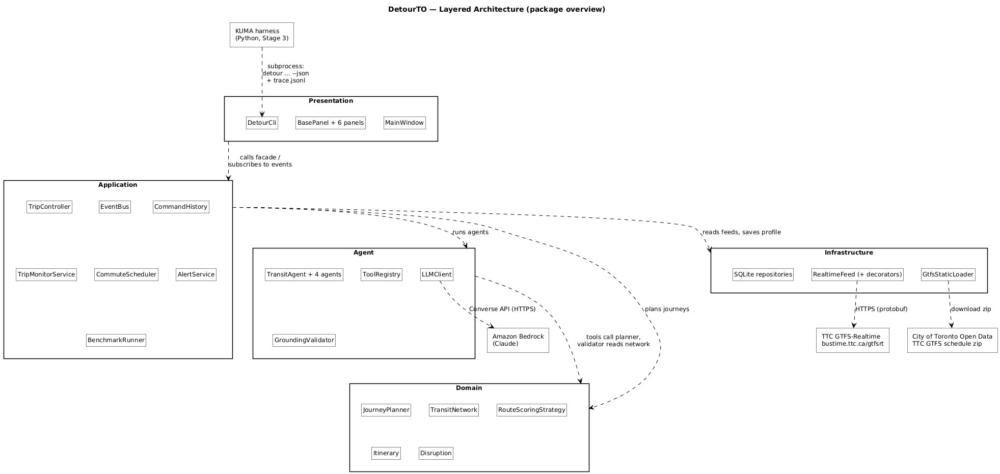

# DetourTO — EECS 3311 Course Project

**A disruption-aware TTC trip planning agent.**

EECS 3311 Software Design, York University, Fall 2026 · Pratham Patel

DetourTO plans trips on the Toronto transit network and keeps them working when things go wrong. You describe a trip in plain English ("York U by 10, no streetcars, step-free please"). A deterministic Java planner computes real itineraries from the TTC's published schedule. An LLM agent (Google Gemini) reads free-text service alerts, re-plans around closures, explains the trade-offs, remembers your places and preferences, and watches an active trip so it can warn you before a disruption ruins it.

The agent proposes and the Java code verifies. Every stop, route, time and itinerary the rider sees was computed by the planner and checked by `GroundingValidator`, never taken from model text.

## Status

| Stage | State |
|---|---|
| Stage 1 — Design | Complete |
| Stage 2 — AI-assisted implementation | Implemented: all 13 features, GUI and CLI (report due Nov 10, 2026) |
| Stage 3 — Testing (JUnit + KUMA) | Not started |

## Running the Code

### Prerequisites

- Java 21 (`java -version`)
- Maven 3.9+ (`mvn -version`)
- For the AI features: a free Google AI Studio API key (Gemini). Tests and `LLM_PROVIDER=scripted` need no key

### Setup

```bash
git clone https://github.com/prathamp18/EECS3311-DetourTO.git
cd EECS3311-DetourTO
cp .env.example .env        # then edit .env with your own values (never commit it)
mvn -q package              # compiles, runs the tests, builds target/detourto.jar
```

`.env` is listed in `.gitignore`. The real key (`GEMINI_API_KEY`) goes only in your local `.env`; `.env.example` holds placeholders only. `LLM_PROVIDER` chooses the model provider: `gemini` or `scripted` (offline).

### Run

```bash
java -jar target/detourto.jar gui                                    # desktop window (Trip Planner, map, monitoring)
java -jar target/detourto.jar --help
java -jar target/detourto.jar plan "York U to Union by 10, no streetcars, I use a wheelchair"   # needs GEMINI_API_KEY
java -jar target/detourto.jar plan --from "York U" --to Union --arrive-by 09:30
java -jar target/detourto.jar plan --from Keele --to "Queens Quay" --strategy fewest-transfers --avoid-mode streetcar
java -jar target/detourto.jar plan --from "St George" --to Union --date 2026-10-22 --depart 08:00 --json
java -jar target/detourto.jar plan "York U to Union by 10" --explain --verbose   # compare options, show agent steps
java -jar target/detourto.jar plan --from Keele --to Union --then "leave 15 min later" --then "avoid line 1" --then undo
java -jar target/detourto.jar places add home "Keele"               # saved places work anywhere a place is expected
java -jar target/detourto.jar places add school "York University"
java -jar target/detourto.jar plan --from home --to school
java -jar target/detourto.jar prefs --learn "never put me on the 29"   # or --strategy, --avoid-route, --step-free
java -jar target/detourto.jar monitor --from "York U" --to Union --depart 08:00 --accept-reroute   # trip states, minute by minute
java -jar target/detourto.jar commute add school --from home --to school --arrive-by 09:00 --days weekdays
java -jar target/detourto.jar commute check                          # when to leave today, with current disruptions
java -jar target/detourto.jar refresh-data                           # download, validate and load the latest TTC schedule
java -jar target/detourto.jar alerts                                 # live alerts as structured disruptions
java -jar target/detourto.jar plan --from "York U" --to Union --ignore-alerts   # compare with the schedule
java -jar target/detourto.jar arrivals "Dufferin" -n 8                # next departures, live delays for buses/streetcars
java -jar target/detourto.jar replay scenarios                        # replay recorded disruptions, report metrics
java -jar target/detourto.jar llm-check --tools                      # check the LLM key and a tool-call round trip
java -jar target/detourto.jar validate-feed                          # check the configured GTFS feed
java -jar target/detourto.jar validate-feed --gtfs data/local/ttc.zip  # or a specific zip/folder
```

Every LLM call, tool call and validation result is published on an event bus and appended to `trace.jsonl` (set `TRACE_FILE` to change it); `--verbose` prints the same steps live. `--explain` compares the options in plain language; the explanation may only cite option ids, minute values and lines that exist in the computed options, otherwise a deterministic comparison is shown.

Follow-ups (`--then`, or the chat box in the GUI) change the current trip one step at a time: leave earlier or later, arrive by a time, avoid a route or mode, change the strategy or destination, `undo`, `redo`. Each change is an undoable command. With a Gemini key the agent interprets the message (its answer is validated); without one, built-in rules handle the common phrasings.

Saved places and preferences live in a local SQLite file (`DB_PATH`, default `data/local/detourto.db`, git-ignored). Preferences apply to every new trip: avoided routes are skipped, step-free riders always get the accessible strategy, and the default strategy is used unless you pick one. A plain-English request that states a lasting preference ("never put me on the 29") is saved by the `PreferenceExtractorAgent` (or built-in rules without a key).

`monitor` follows one option through its states: Planned, On track, At risk (a disruption on the remaining route, a likely missed connection, or arriving after the arrive-by time), Rerouted and Completed. The CLI replays the trip minute by minute against the configured feed; by default the trip is planned as if today's alerts were not known yet, so the monitor has something to catch. The GUI monitors on the real clock.

Commutes (`commute add|list|remove|check`) compute today's leave-by time with current disruptions and say how much earlier than usual you need to leave and why; the GUI checks every minute and warns `--warn` minutes before (once per commute per day). `refresh-data` downloads the TTC schedule from Toronto Open Data (or `--file` a local zip), validates it, and only swaps it in if it is valid.

Planning routes around active disruptions by default. Alerts that name stops and an effect in their structured fields become disruptions directly; free-text alerts are read by the `AlertInterpreterAgent`, whose stop ids are checked against the network. Interpretations below 50% confidence are listed but only applied with `--avoid-disruption <id>`.

`plan` options: `--from`/`--to` (station or street name, stop id, or `lat,lon`), `--depart` or `--arrive-by` (`HH:mm`, ISO date-time, or `now`), `--date`, `--strategy` (`fastest`, `fewest-transfers`, `least-walking`, `accessible`), `--avoid-route`, `--avoid-mode`, `--max-walk`, `--avoid-disruption`, `--ignore-alerts`, `--explain`, `--verbose`, `--then`, `--json`. Exit codes: 0 options found, 3 no route, 4 a place needs clarifying, 5 the request could not be understood.

With a plain-English request, the LLM only produces a structured trip query: it must look up every place with the `find_stop` tool, and the `GroundingValidator` rejects any stop id that did not come from a tool result. The routes and times always come from the Java planner.

`scenarios/` holds replay scenarios for `detour replay` (F12): a time, a request, recorded alerts and the stops that were really closed. The report shows whether the interpreted closures match, whether a route still exists, the extra travel time, grounding violations, LLM calls and latency. Without an LLM key, scenarios run from their `from`/`to` fields and only structured alerts are interpreted.

`data/sample/realtime` holds a recorded GTFS-Realtime feed for the sample network (delays on the 510 and 29, plus four service alerts), generated by `tools/make_sample_realtime.py`. Set `TTC_FEED_BASE_URL=https://bustime.ttc.ca/gtfsrt` to read the live TTC feed instead; live trip ids only match the real TTC schedule. If the feed fails, DetourTO keeps working on scheduled times (circuit breaker plus last good data).

`data/sample/mini-gtfs` is generated by `tools/make_sample_gtfs.py`. It is a simplified network for tests and demos (fixed headways, approximate coordinates), not real TTC schedules.

By default the app uses the small sample network in `data/sample/mini-gtfs` (72 stops, 5 routes), so it runs without downloading anything. To use the **whole TTC network**:

```bash
java -jar target/detourto.jar refresh-data          # downloads the latest TTC schedule into data/local/ttc-gtfs.zip
```

then set these two lines in `.env` (the second switches to the live TTC feed, which matches the real schedule):

```
GTFS_PATH=data/local/ttc-gtfs.zip
TTC_FEED_BASE_URL=https://bustime.ttc.ca/gtfsrt
```

The TTC lists every subway platform and bus bay as a separate stop; the loader groups stops named "... Station" into one station, so `--from "Don Mills" --to "Pioneer Village"` finds the stations.

### Tests

```bash
mvn test
```

## Features

Every feature works from the desktop window and from the `detour` command line (`--json` output where it matters, for Stage 3 KUMA tests).

| ID | Feature | GUI | CLI |
|---|---|---|---|
| F01 | Natural-language trip request | Trip Planner, Ask box | `detour plan "York U to Union by 10, no streetcars"` |
| F02 | Multi-option journey planning (RAPTOR) | Trip Planner form, options list, map | `detour plan --from ... --to ... --arrive-by 09:30` |
| F03 | Route preference strategies | Trip Planner, Rank by | `--strategy fastest\|fewest-transfers\|least-walking\|accessible` |
| F04 | Service alert interpretation | Alerts tab | `detour alerts` |
| F05 | Disruption-aware re-routing | Alerts, "Re-route my trip around this"; map shows closures | `detour plan ... --avoid-disruption <id>`, `--ignore-alerts` |
| F06 | Grounded explanation of the options | Trip Planner, Explain | `detour plan ... --explain` |
| F07 | Live trip monitoring | Trip Planner, Start trip / Accept reroute | `detour monitor --from ... --to ... --accept-reroute` |
| F08 | Stop arrivals board | Arrivals tab | `detour arrivals "Dufferin"` |
| F09 | Saved places and preference memory | Commute & Profile tab | `detour places add home "Keele"`, `detour prefs --learn "..."` |
| F10 | What-if follow-ups with undo/redo | Trip Planner Ask box, Undo / Redo | `detour plan ... --then "leave 15 min later" --then undo` |
| F11 | Commute watch and leave-by alerts | Commute & Profile tab | `detour commute add\|list\|remove\|check` |
| F12 | Disruption replay and benchmark | Benchmark tab | `detour replay scenarios` |
| F13 | Transit data refresh and validation | Benchmark, "Refresh transit data" | `detour refresh-data [--file zip]` |

## Design Patterns in the Code

| Pattern | Where |
|---|---|
| Strategy | `domain/RouteScoringStrategy` + `FastestStrategy`, `FewestTransfersStrategy`, `LeastWalkingStrategy`, `AccessibleStrategy` |
| Facade | `application/TripController` (the only entry point for the GUI and CLI) |
| Adapter | `agent/GeminiAdapter` (Gemini REST to `LLMClient`), `infrastructure/GtfsRealtimeAdapter` (GTFS-RT protobuf to domain) |
| Factory | `agent/LLMClientFactory`, `application/QueryCommandFactory` |
| Template Method | `agent/TransitAgent.run()` with `TripRequestAgent`, `AlertInterpreterAgent`, `ExplanationAgent`, `PreferenceExtractorAgent` |
| Decorator | `infrastructure/RealtimeFeedDecorator` + `CachingRealtimeFeed`, `ResilientRealtimeFeed` (with `CircuitBreaker`) |
| Observer | `application/EventBus`, `EventListener`; `TraceLogger`, `ConsoleNotifier`, GUI panels |
| Command | `application/QueryCommand` + 5 commands, `CommandHistory` (undo/redo) |
| State | `application/ActiveTrip` + `PlannedState`, `OnTrackState`, `AtRiskState`, `ReroutedState`, `CompletedState` |

## Stage 1 Report

**[docs/DetourTO-Stage1-Design-Report.md](docs/DetourTO-Stage1-Design-Report.md)**. The whole report is in one document, and GitHub shows the diagrams inline. A PDF copy is at [docs/DetourTO-Stage1-Design-Report.pdf](docs/DetourTO-Stage1-Design-Report.pdf).

| Section | Contents |
|---|---|
| 1 | Problem, users, what the agent does, why an agent, AI model and integration, architecture, technology |
| 2 | 13 feature specifications (description, GUI interaction, input, output, AI involvement, workflow, error cases) |
| 3 | UML class diagram: one model shown as 6 layer views, relationships and multiplicities |
| 4 | 8 design patterns from the course, each with its own diagram, plus supporting patterns and SOLID |
| 5–6 | Use case diagram (6 actors, 19 use cases) and full use case descriptions |
| 7 | 11 sequence diagrams |
| 8 | Feature-to-design traceability table |
| 9 | How each feature is realised by classes and methods |
| 10 | Stage 2/3 test plan (JUnit targets, KUMA behavioural requirements), CLI map, requirements checklist |

## Architecture at a Glance



```
Presentation    MainWindow + 5 JavaFX tabs, DetourCli (picocli)
Application     TripController «Facade», EventBus «Observer», CommandHistory «Command»,
                TripMonitorService + ActiveTrip «State», AlertService, CommuteScheduler, BenchmarkRunner
Agent           TransitAgent «Template Method» + 4 agents, ToolRegistry + tools,
                LLMClient ← GeminiAdapter «Adapter», ResponseParser, GroundingValidator
Domain          TransitNetwork, NetworkView, JourneyPlanner (RAPTOR), RouteScoringStrategy «Strategy»,
                Itinerary, Leg, Disruption, PlaceResolver
Infrastructure  RealtimeFeed ← GtfsRealtimeAdapter «Adapter», RealtimeFeedDecorator «Decorator»,
                GtfsStaticLoader, SQLite repositories, AppConfig
```

## Technology (Stage 2)

| Concern | Choice |
|---|---|
| Language, build | Java 21, Maven |
| GUI | JavaFX 21 (`detour gui`); map drawn on a Canvas, works offline |
| CLI | picocli, command `detour`, `--json` on every command |
| LLM | Google Gemini API (REST generateContent with function calling), no LangChain4j |
| Transit data | TTC GTFS schedule (City of Toronto Open Data) + TTC GTFS-Realtime (`bustime.ttc.ca/gtfsrt`) |
| Storage | SQLite (`sqlite-jdbc`) behind repository interfaces |
| Unit tests | JUnit 5 (170+ tests, no network needed: scripted LLM, local fake Gemini server, recorded feeds) |
| Agent tests | KUMA (Python SDK) driving `detour ... --json` as a subprocess and reading `trace.jsonl` |

## Source Layout

```
pom.xml
src/main/java/ca/yorku/eecs3311/detourto/
  presentation/     DetourCli + one command class per feature, JsonResultWriter, TextResultWriter, ConsoleNotifier
  presentation/gui/ MainWindow, BasePanel + 5 tab panels, MapPanel
  application/      TripController, EventBus, commands, TripMonitorService, trip states,
                    AlertService, CommuteScheduler, BenchmarkRunner
  agent/            TransitAgent + 4 agents, LLMClient, GeminiAdapter, ScriptedLLMClient,
                    ToolRegistry + tools, ResponseParser, GroundingValidator, offline rules
  domain/           TransitNetwork, NetworkView, JourneyPlanner, strategies, Itinerary, Disruption, ...
  infrastructure/   GtfsRealtimeAdapter, feed decorators, CircuitBreaker, GtfsStaticLoader,
                    SQLite repositories, AppConfig
src/test/java/      JUnit 5 tests mirroring the packages
scenarios/          recorded disruption scenarios for replay and KUMA
tools/              sample data generators (Stage 3 adds the KUMA harness)
```

## Diagrams

Every diagram is delivered in two formats that show the same picture: a **UMLet 15.1 `.uxf` file** and UMLet's own export (SVG, plus a 2x PNG that the report displays). Each set shares a name.

```
docs/diagrams/
  uxf/          28 UMLet files (architecture, 6 class views, 9 pattern views, use case, 11 sequence diagrams)
  svg/          UMLet's SVG export of each .uxf
  png/          the same exports as PNG, what the report displays
  src/          the sources the .uxf files are generated from (build input)
  generators/   the scripts that turn those sources into UMLet XML and run UMLet's exporter
```

The class diagram is one model, `docs/diagrams/src/model.iuml`, cut into six layer views and nine pattern views, so the views cannot disagree with each other or with the sequence diagrams. UMLet has no PlantUML import, so the `.uxf` files are generated rather than redrawn. Every `.uxf` was opened and exported with UMLet 15.1 to confirm it loads without errors, and those exports are the committed images. See [`docs/diagrams/README.md`](docs/diagrams/README.md) for the regeneration commands.

## Data Licence

Contains information licensed under the Open Government Licence – Toronto.
